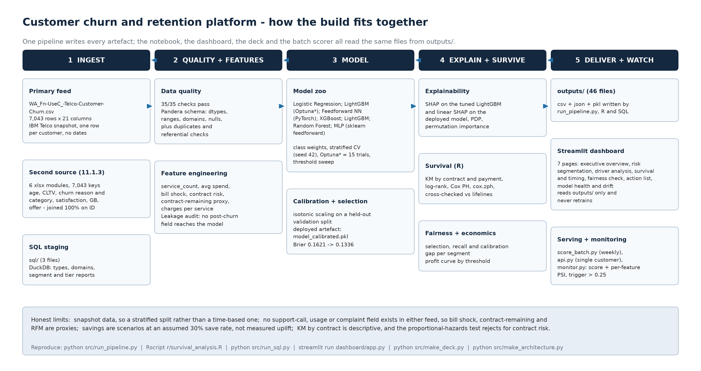
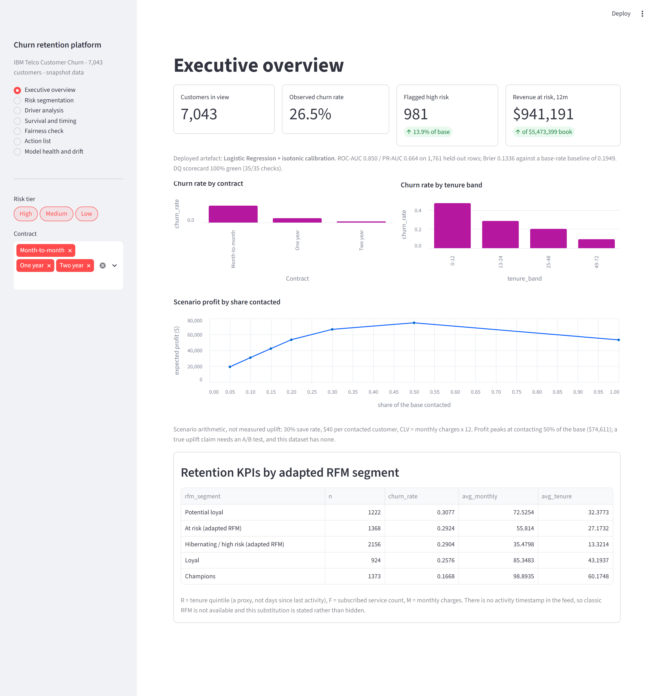
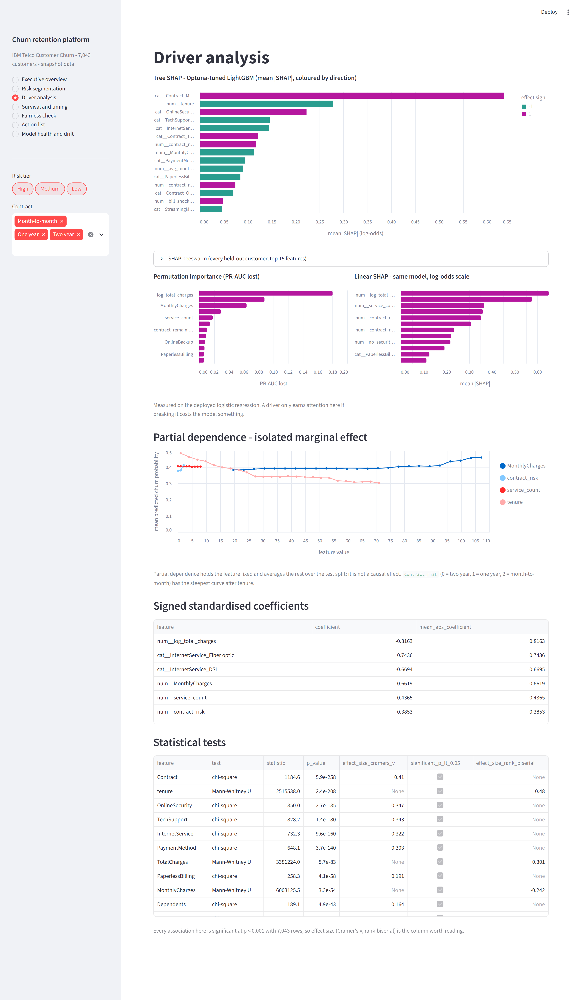
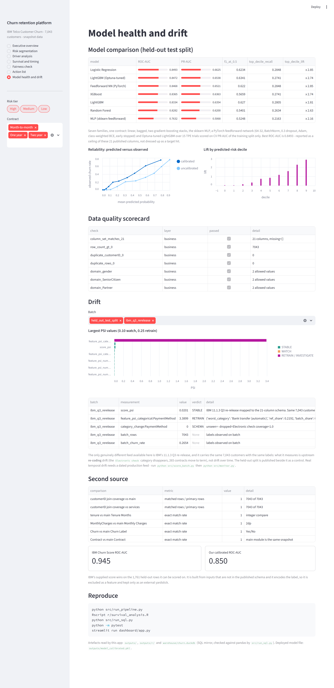

# Customer Churn Prediction and Retention Analytics Platform

**Stack:** Python + R + SQL • **Dashboard:** Streamlit • **Data:** IBM Telco Customer Churn, 7,043 customers × 21 columns

**Live dashboard:** <https://customer-churn-retention-platform-eusx5jhkbcd5eztcurbyam.streamlit.app/>
Deep-linkable, so `?page=survival` or `?page=fairness` opens that page directly. It reads the
committed `outputs/` files in this repo and never retrains, which is why the hosted numbers and
the numbers below are the same numbers.

A telecom client loses subscribers, but retention offers go to everyone equally.
This pipeline answers: who will churn, why, when, and who is worth the spend.
Everything on screen is a committed artefact — the dashboard and the API read what
`src/run_pipeline.py` wrote, they never retrain.

## Verified headline numbers (this build)

- Base churn: **26.5%** (1,869 of 7,043)
- Data quality: **35/35 checks green** (Pandera schema + range / referential / business rules, `outputs/dq_scorecard.csv`)
- Deployed artefact: **Logistic Regression + isotonic calibration** — on 1,761 held-out rows
  ROC-AUC **0.8495**, PR-AUC **0.6637**, Brier **0.1336** against a base-rate baseline of **0.1949**
- Model zoo (`outputs/model_comparison.csv`, seven families on one contract):
  Logistic 0.8493 / 0.6625, LightGBM (Optuna-tuned) 0.8472 / 0.6538, **PyTorch feedforward NN 0.8468 / 0.6521**,
  XGBoost 0.8365 / 0.6363, LightGBM 0.8334 / 0.6354, Random Forest 0.8282 / 0.6200, sklearn MLP 0.7632 / 0.5068
- High-risk customers at the deployed 0.60 cutoff: **981 of 7,043**, carrying **$941,191** of a $5.47M annual book
- Scenario profit (30% save rate, $40 per contact): peaks at contacting **50% of the base → $74,611**;
  the profit-maximising score threshold is **0.15**. Scenario arithmetic, not measured uplift.
- Survival: median time-to-churn **35 months** for month-to-month, **not reached** for one- and two-year terms.
  Cox contract-risk hazard ratio **5.55**, electronic check **1.64**, service count **0.60** (protective).
- R cross-check: `lifelines` and R `survival` 3.8.6 agree on every hazard ratio to **2.4e-06**
- Fairness (held-out, `outputs/fairness_by_segment.csv`): senior citizens are flagged 2.58x more often than
  non-seniors and their recall is **13.4pp** higher; the largest calibration gap across all seven dimensions is
  **2.7pp**. Gender is near-parity (selection ratio 0.907).
- Drift on a genuinely different feed: IBM's 11.1.3 Q3 re-release scores **STABLE** on the model output
  (score PSI **0.0201**) but **RETRAIN** on `PaymentMethod` (feature PSI **3.39**) — see Limitations for what that does and does not measure
- Second-source yardstick: IBM's supplied Churn Score reaches ROC-AUC **0.945** on the same 1,761 rows
  versus our **0.850**; it encodes the label, so it is excluded as a feature and kept only as a benchmark
- Tests: **144 passing** (`pytest`), covering DQ, features, scoring, the API, the SQL mirror, drift and the
  document generators

## Architecture



```
Raw Telco CSV → DQ (Pandera) → features (proxies only, leakage-audited) → model zoo (sklearn / XGBoost /
LightGBM / PyTorch) → Optuna → isotonic calibration → SHAP + PDP + coefficients → R survival (lifelines
cross-check) → fairness by segment → retention actions → DuckDB + SQL mirror → Streamlit (7 pages)
→ batch scoring + PSI monitoring → FastAPI single-customer endpoint
```

## Dashboard — Streamlit, seven pages

Live at <https://customer-churn-retention-platform-eusx5jhkbcd5eztcurbyam.streamlit.app/>, or run it
with `streamlit run dashboard/app.py`; both are deep-linkable via `?page=`. Sidebar filters on risk tier and contract
apply to every page. Screenshots are in `docs/screenshots/` and regenerate with
`python dashboard/capture_screenshots.py` (headless Chrome over the DevTools protocol — a plain
`chrome --screenshot` writes a blank page because Streamlit streams over a websocket).

| Page | What it answers |
| --- | --- |
| [Executive overview](docs/screenshots/dashboard_overview.png) | deployed model, churn by contract and tenure, scenario profit curve, adapted-RFM KPI table |
| [Risk segmentation](docs/screenshots/dashboard_segments.png) | tier summary with mean predicted versus observed churn, probability histogram, filterable customer list |
| [Driver analysis](docs/screenshots/dashboard_drivers.png) | tree SHAP on the tuned LightGBM, beeswarm, permutation importance, linear SHAP, partial dependence, coefficients, association tests |
| [Survival and timing](docs/screenshots/dashboard_survival.png) | KM curves by contract / payment, median survival, lifelines-versus-R hazard ratios, Schoenfeld verdict |
| [Fairness check](docs/screenshots/dashboard_fairness.png) | subgroup selection, recall, FPR and calibration gap for seven segment dimensions |
| [Action list](docs/screenshots/dashboard_actions.png) | the offer list itself, with the cause-to-playbook map behind it |
| [Model health and drift](docs/screenshots/dashboard_health.png) | model comparison, reliability curves, DQ scorecard, drift PSI, second-source benchmark, reproduce block |

Three of them, inline:







## What is in the repo

- `src/run_pipeline.py` — the whole build, one command, writes every artefact in `outputs/`
- `src/features.py` — the single feature contract (16 categorical + 16 numeric inputs → 61 model features)
  that the pipeline, batch scorer, API, SQL mirror, notebook and tests all import
- `customer_churn_retention_platform.ipynb` — executed notebook (78 cells, 0 errors, 5 embedded figures).
  It imports the same modules rather than re-implementing them, and its last cell asserts the notebook and
  the pipeline agree to the digit on all seven models, the calibration metrics and the tier counts
- `dashboard/app.py` + `dashboard/capture_screenshots.py` — the seven-page viewer and its screenshot driver
- `sql/01_ingest.sql`, `02_dq_checks.sql`, `03_reporting.sql` against `warehouse/churn.duckdb`
  (`python src/run_sql.py` rebuilds it and reconciles every aggregate against pandas)
- `r/survival_analysis.R` + `outputs/r/` — KM tables, log-rank, Cox, Schoenfeld residuals and the plots, all
  produced by an actual `Rscript` run
- `tests/` — 144 tests across 9 files (DQ, features, scoring, API, SQL, monitor, external feeds, documents)
- `docs/data_dictionary.md` — all 21 columns: type, role, allowed values, nulls, how it is used, and what it
  must not be used for
- `docs/api_smoke_test.md` — the FastAPI endpoint started with uvicorn and called for real, request and
  response included
- `executive_summary.pptx` (2 slides) and `executive_summary.pdf` (the same 2 pages for print) — both written by
  `python src/make_deck.py`, which reads `outputs/` at build time, so the deck cannot keep quoting last run's
  numbers. It also fails rather than overflowing a column
- `docs/architecture.png` — regenerated by `python src/make_architecture.py` from the repo tree and `outputs/`
- `outputs/scored_customers.csv`, `retention_actions.csv`, `model_calibrated.pkl` (the deployed artefact)

## Run it

```bash
python3 -m venv .venv
.venv/bin/pip install -r requirements.txt
.venv/bin/python src/run_pipeline.py        # every artefact in outputs/ + figures/
.venv/bin/python src/run_sql.py             # DuckDB warehouse + SQL/pandas reconciliation
Rscript r/survival_analysis.R               # needs R with survival, dplyr, ggplot2
.venv/bin/python -m pytest -q               # 144 tests
streamlit run dashboard/app.py              # the seven-page dashboard
uvicorn src.api:app --port 8000             # POST /score, docs at /docs
.venv/bin/python src/score_batch.py new_snapshot.csv && .venv/bin/python src/monitor.py
.venv/bin/python src/make_deck.py           # executive_summary.pptx + .pdf from outputs/
.venv/bin/python src/make_architecture.py   # docs/architecture.png
```

## Honest limitations — say these out loud

- **The feed has no behavioural columns.** There is no support-call, login, usage, complaint,
  payment-delay or signup-date field, so those features were not fabricated. Bill shock,
  contract-remaining and adapted RFM are proxies built from the 21 published columns only.
- **No time-based split is possible on a snapshot.** This build uses a stratified train/test split
  (seed 42) plus stratified CV. A dated production feed must switch to a time-based split.
- **"Drift" here is re-coding drift, not temporal drift.** The only genuinely different feed available is
  IBM's Q3 re-release, and it carries the same 7,043 customers with the same labels: the `PaymentMethod`
  PSI of 3.39 measures `Electronic check` disappearing upstream and 265 contracts moving to term, not
  customers changing behaviour over time. The held-out split is published beside it as a control (PSI 0.0038).
- **Single primary source.** One public dataset plus its re-release; the second "source" is IBM's own
  Churn Score column, used only as an external yardstick and never as a feature.
- **Profit and expected-savings figures are scenarios** (30% save rate, $40 per contacted customer,
  CLV = monthly charges × 12). Claiming uplift needs an A/B test; this dataset has none.
- **KM by contract is descriptive.** Contract is observed at the snapshot, not at signup, so the curves
  cannot be read as "signing a two-year term causes retention". Cox proportional hazards is rejected for
  four covariates (Schoenfeld p < 1e-16), so those hazard ratios are time-averaged, and the operational
  calls come from the KM curves and the classifier rather than from a Cox p-value.
- **Fairness coverage is partial.** `SeniorCitizen`, `gender` and `Dependents` are the closest things to
  protected attributes this feed carries; there is no race, ethnicity or national-origin field, so the
  check is labelled partial rather than presented as an audit.

## Data

- IBM Telco Customer Churn (CN0003), 7,043 rows × 21 columns, 0 duplicate rows, 11 blank `TotalCharges`
  (all tenure-0, set to 0 in cleaning). Mirror in `data/raw/`, every column documented in
  `docs/data_dictionary.md`.
- Second file: the same study's 11.1.3 Q3 re-release, used for the drift and cross-source reconciliation
  checks in `outputs/drift_report.csv` and `outputs/source_reconciliation.csv`.
